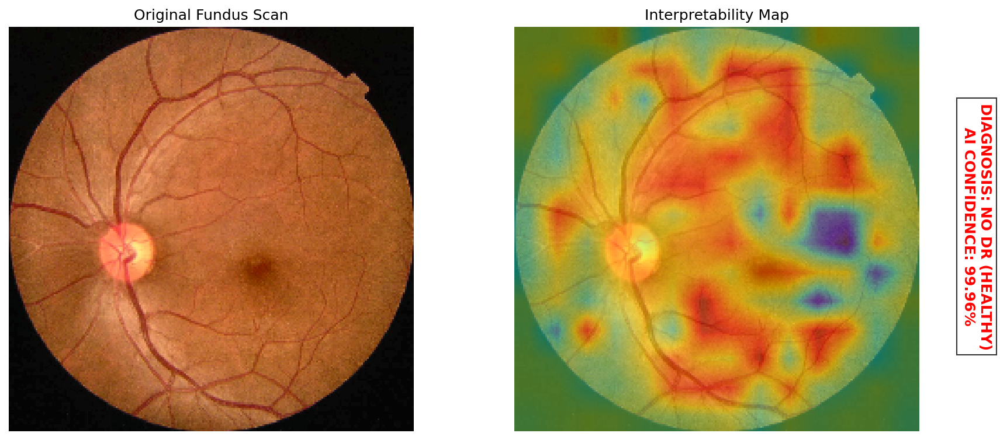
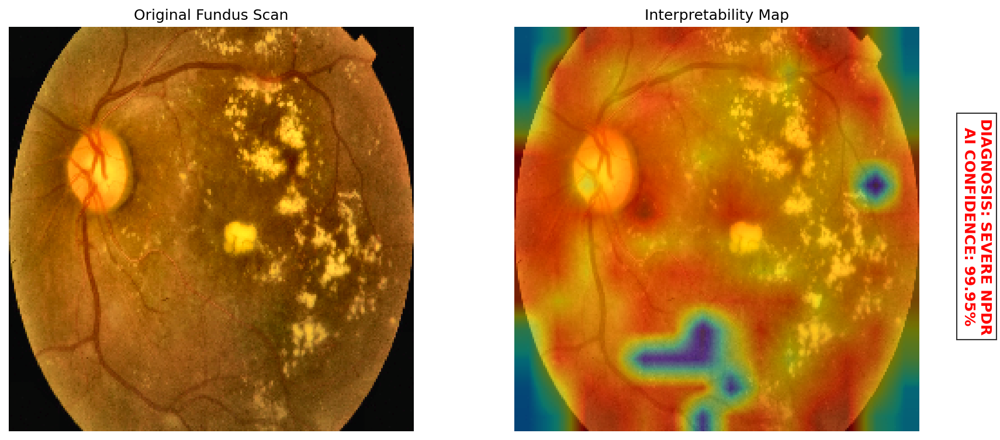
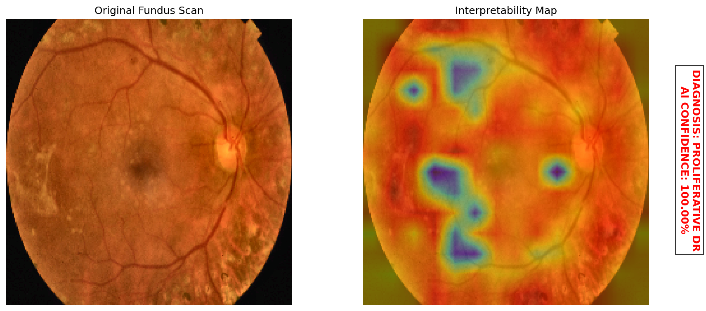

# RetinaFlow — AI Diabetic Retinopathy Screening

Diabetic retinopathy (DR) is one of the leading causes of preventable blindness, and early detection depends on access to specialists who are scarce in many regions. **RetinaFlow** is a full-stack screening tool that grades a retinal fundus image into one of five DR severity levels and shows *why* the model made its decision.

## Features

- **5-class severity grading** — No DR, Mild NPDR, Moderate NPDR, Severe NPDR, Proliferative DR
- **Confidence scores** for every prediction
- **Explainable AI** — Grad-CAM heatmaps highlight the retinal regions that drove the prediction, scaled by model confidence (faint for healthy, vivid for diseased)
- **Preprocessing pipeline** — automatic black-border cropping and CLAHE contrast enhancement to make small lesions such as microaneurysms more visible
- **Web app + WebAR viewer** — upload an image in the React app, or view results interactively in augmented reality

## Results

Grad-CAM explanations across all five severity grades:

| Grade | Example |
|---|---|
| No DR (Healthy) |  |
| Mild NPDR |  |
| Moderate NPDR |  |
| Severe NPDR |  |
| Proliferative DR |  |

## How it works

```
Fundus image ──► Auto-crop + CLAHE ──► ViT-B/16 (fine-tuned) ──► Severity + confidence
                                              │
                                              └──► Grad-CAM ──► Heatmap overlay
```

**Model:** Vision Transformer (`vit_base_patch16_224`, via `timm`) fine-tuned for 5-class classification at 224×224 resolution, with data augmentation. Evaluated with quadratic weighted kappa (QWK), the standard metric for ordinal DR grading.

## Tech stack

| Layer | Tools |
|---|---|
| Model | PyTorch, timm, scikit-learn, OpenCV |
| Backend | FastAPI, Uvicorn |
| Frontend | React, Vite, Tailwind CSS |
| AR | MindAR, A-Frame |
| Deployment | DigitalOcean (API), Vercel (frontend) |

## Project structure

```
├── ViT_DR_Implementation.py   # Training: preprocessing, ViT fine-tuning, QWK evaluation
├── ViT_DR_Inference.py        # Standalone inference + Grad-CAM visualisation
├── generate_clean_csv.py      # Cleans dataset CSVs against available images
├── backend/                   # FastAPI inference API (/predict)
├── frontend/                  # React web app + WebAR viewer
├── deploy/                    # Server setup and deployment scripts
└── final_project_results/     # Grad-CAM outputs for each severity grade
```

## Running locally

**Backend**
```bash
cd backend
pip install -r requirements.txt
# place trained weights at ../vit_dr_final.pth
uvicorn app:app --reload
```

**Frontend**
```bash
cd frontend
npm install
npm run dev
```

> The trained model weights (`vit_dr_final.pth`, ~343 MB) are not included in this repository.

## Disclaimer

This is an academic project and is not a medical device. It is not intended for clinical diagnosis.
